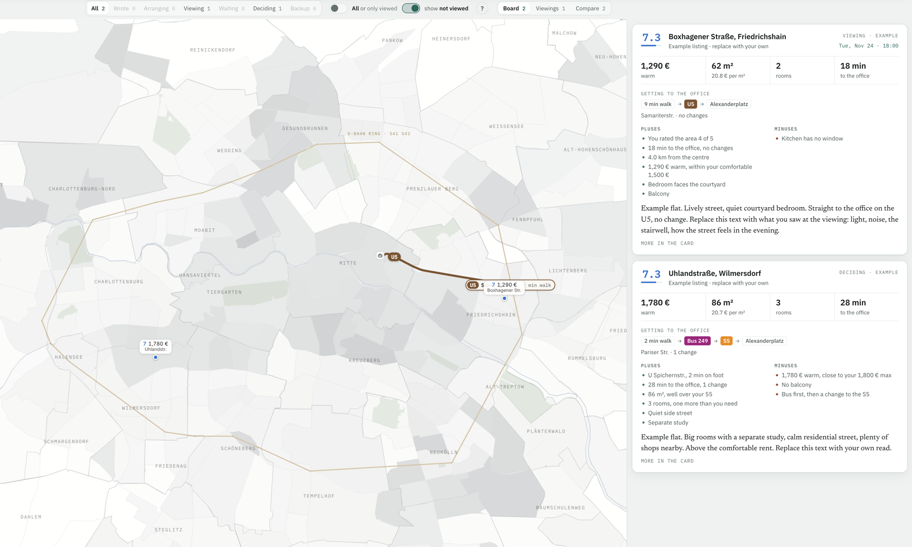

# berlin-flat-bot

A flat hunt in Berlin for people who don't want to refresh portals at 11pm.
The bot watches the listings, drops what you would drop, and sends the rest to
Telegram. The board puts the flats you're considering on a map and helps you
pick one.



Your criteria live in `profile.json`. A ten-minute interview writes it.

## The bot

- **Filters.** Sixteen checks, cheapest first. They cover duplicates, bait
  prices, scams, your deal-breakers and areas you ruled out. They also check the
  real transit route to the places you need and the rent ceiling.
  `docs/card.md` lists them.
- **Scores.** What survives is scored out of 100 on your own weights.
- **Card.** Rent warm, cold and per m², the nearest station, minutes to each of
  your places, neighbourhood stats from Berlin's LOR data, and what's nearby.
- **Never guesses.** If a server is down, the card says *not measured*.

Built on [Fredy](https://github.com/orangecoding/fredy), which you run
yourself (`docs/fredy.md`).

## The board

`dashboard/` works without the bot. It shows:

- every flat on a map of Berlin
- a card per flat scored on your priorities, with pluses and minuses
- the trip to your office in BVG line colours
- a side-by-side comparison
- a 3D walk-through of a floor plan with the sun

It opens with two example flats. `dashboard/README.md` shows how to add yours
and set your office.

## Start

```sh
python3 data/fetch.py          # Berlin nursery and school registers, once
python3 intake/interview.py    # answer the questions, get profile.json
python3 -m http.server 8000    # board at http://localhost:8000/dashboard/
```

Then `docs/setup.md` for Telegram, Fredy and mail. Re-run the interview any
time to edit your answers.

> **Partly built.** The interview, filters, scoring, Fredy loop and board work
> and are tested. The mail reader and extra portal watchers are not done yet.
> See [STATUS.md](STATUS.md).

## Layout

```
profile.json          yours, git-ignored
intake/interview.py   the questions
src/                  filters, scoring, what is nearby
data/                 Berlin registers and neighbourhood statistics
fredy/providers/      scrapers for Berlin's municipal housing companies
dashboard/            the board: map, cards, comparison, 3D plans
docs/                 setup, telegram, fredy, mail, nearby
```

## Licence and data

MIT, see `LICENSE`. Fredy is separate and its licence forbids selling it or
anything built on it.

- Neighbourhood stats, nursery and school registers: Geoportal Berlin, Datenlizenz Deutschland Namensnennung 2.0
- Places: OpenStreetMap contributors, ODbL
- Routing: [transitous](https://transitous.org)
- Geocoding: Nominatim, one request per second, please keep it that way
